

# School Management System

An Arabic, right-to-left platform that runs a school day to day, with a separate portal where parents follow their own child: students and groups, attendance, progress tracking, curriculum follow-up, subscriptions, planning, evaluations, reports and an audit log.

> **The source code is private.** This repository shows what the system does and how it is built. Every school, teacher, parent and student on this page is **fictional**; the screenshots come from a demonstration installation ("Horizon School").

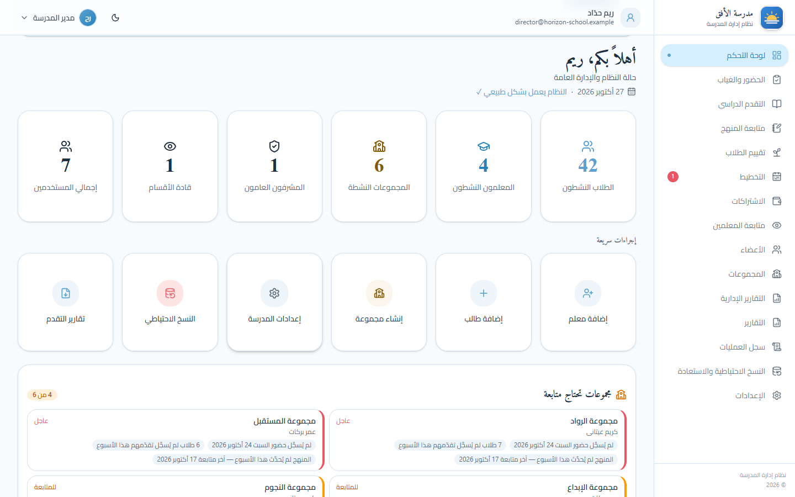

## The problem

A school runs on many small records kept by many people. On paper and in spreadsheets those records disagree, and nobody can tell who changed what.

- **Students and groups:** who is in which group, under which teacher, and who left.
- **Attendance and progress:** every session, and how each student is moving along.
- **Finance:** monthly subscriptions, partial payments, and who is behind.
- **Administration:** staff who should see only their part, and reports leadership can trust.

## One system, two sides

| For the school: the staff application | For parents: the family portal |
|---|---|
| **Director:** everything, including accounts, backups and system health | **Progress:** attendance, learning progress, evaluations and medals |
| **General supervisor:** runs the school day to day | **Weekly assignment:** the parent marks it read, then done |
| **Team leader:** supervises their teachers and groups | **Subscriptions:** what has been paid and what is still due |
| **Teacher:** attendance, progress and evaluations for their own groups | **Teachers' notes:** comments on progress and evaluations |

A parent signs in with the student's number and a 4-digit PIN and sees **one child and nothing else**.

## Screenshots

### The director's day

The dashboard points at gaps, not only totals: groups with no attendance on the last class day, students with no progress recorded this week, or a curriculum that was not updated.

| Dashboard | Groups that need follow-up |
|---|---|
|  | 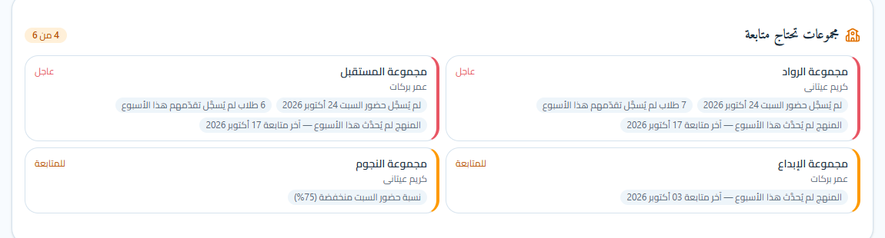 |
| Counts, quick actions, notes waiting for the director. | Each group is flagged *urgent* or *to follow up*, with the reason. |

### People, groups and finance

| A student's profile | Subscriptions |
|---|---|
| 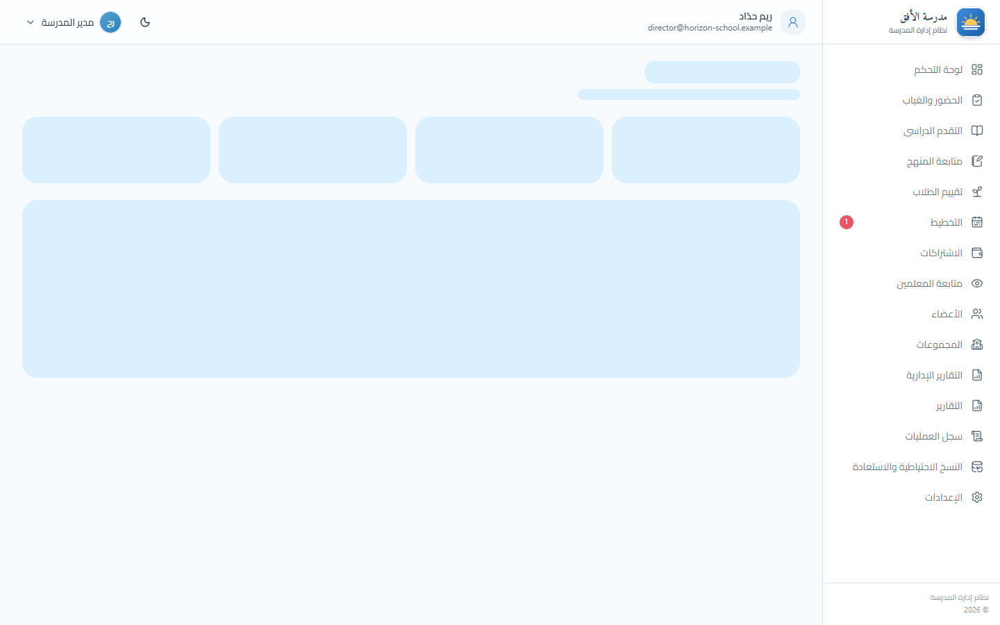 | 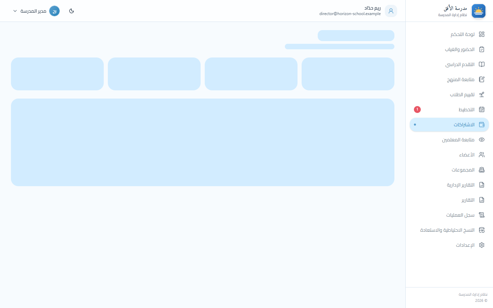 |
| Study, guardian and contact details, the parent's account, and the attendance record. | Monthly status per student, with totals for due, paid and remaining. |

| Recording a payment | Members and groups |
|---|---|
| 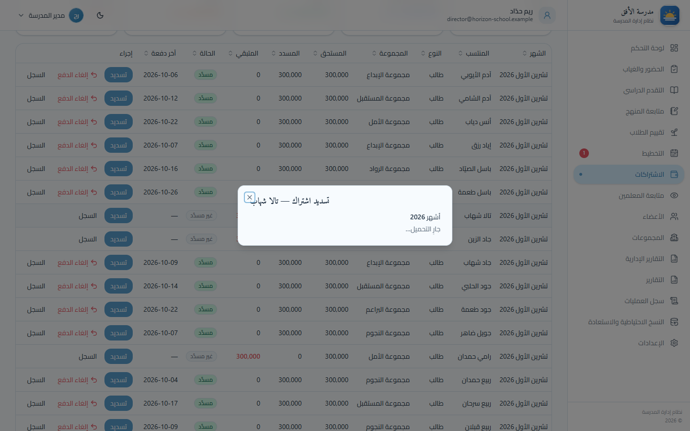 | 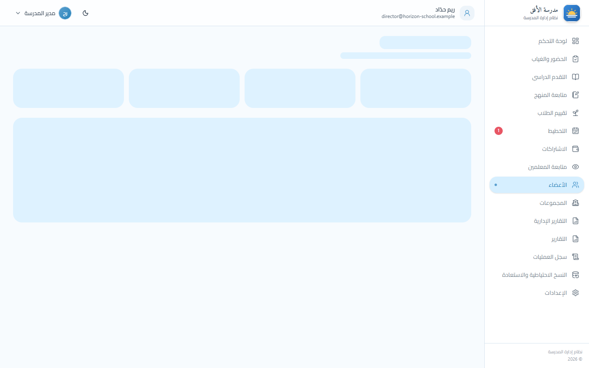 |
| Payments are recorded against months, not as loose amounts. A partial payment is split evenly over the months it covers. | One list for students and staff, each with a school number. |

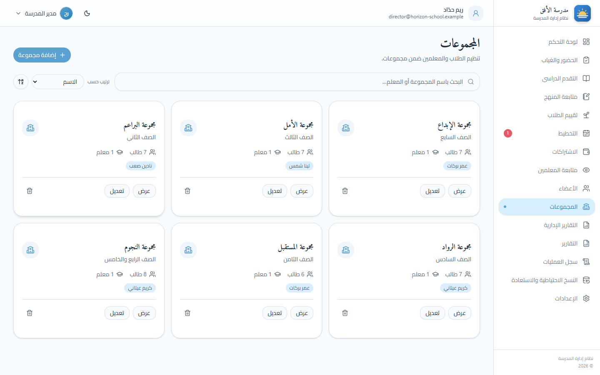

### Teaching

| Evaluations | Monthly planning |
|---|---|
| 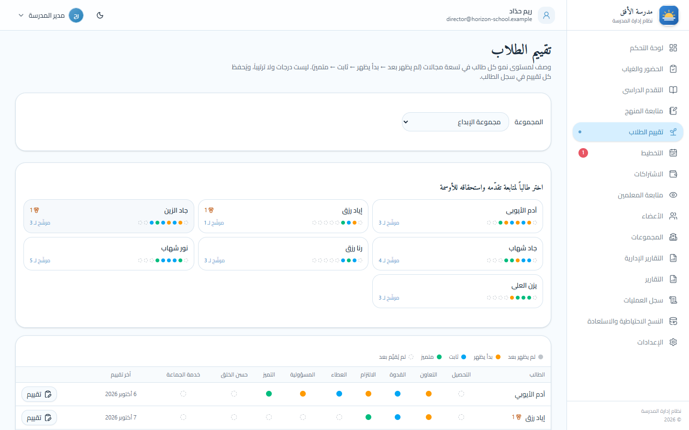 | 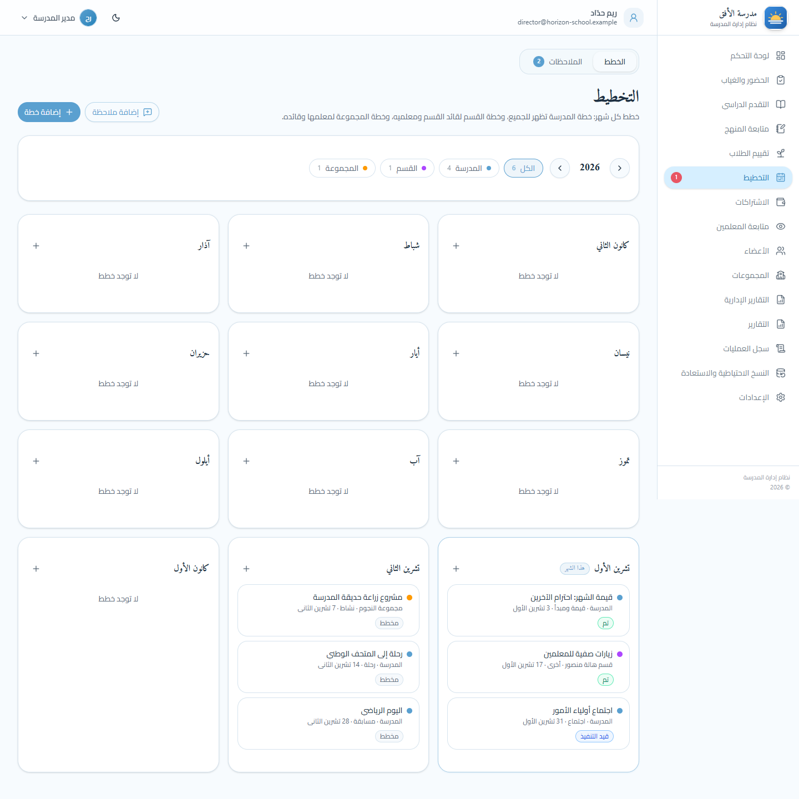 |
| Each student's growth in nine areas, on a four-step scale that describes growth and is never added up into a mark. | The year at a glance: school, section and group plans with their status. |

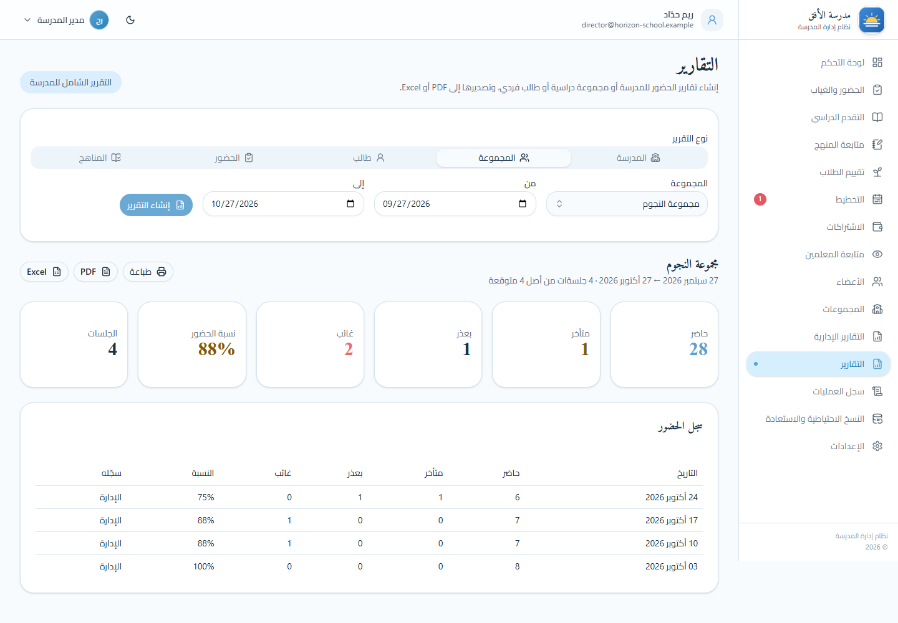

### On a phone

Teachers take attendance with one hand, during the session. Everyone starts present, so the teacher only taps the exceptions; the counters update with each tap. Without internet, the record is kept on the phone and sent by itself when the connection is back.

| A teacher's home | Taking attendance | Parent sign-in | A parent's overview |
|---|---|---|---|
| 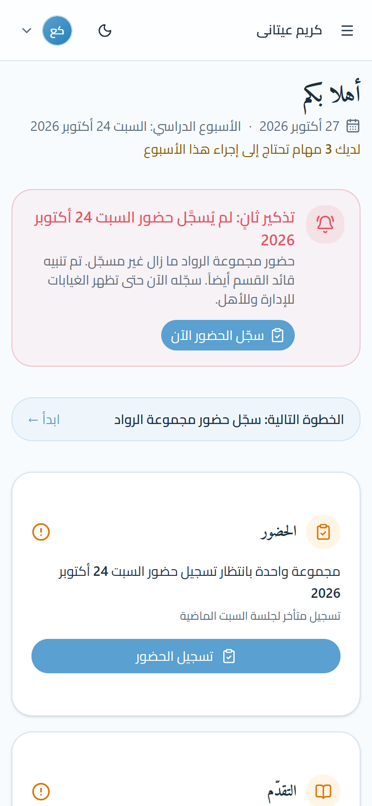 | 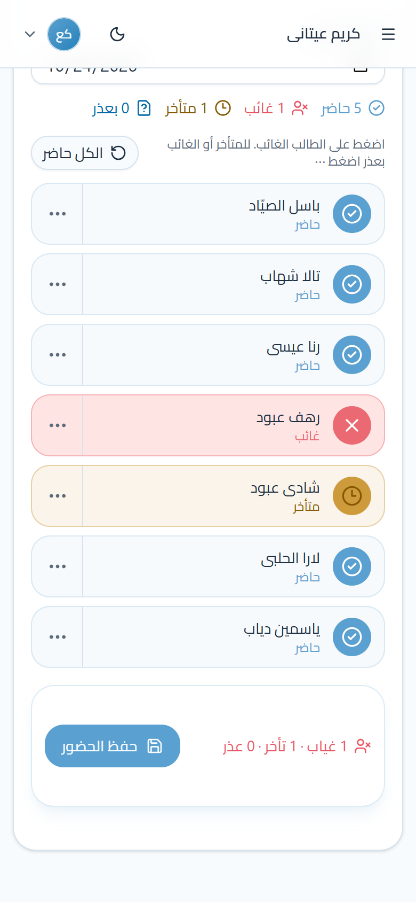 | 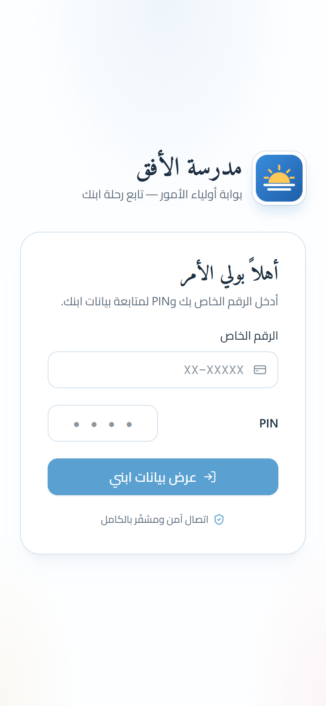 | 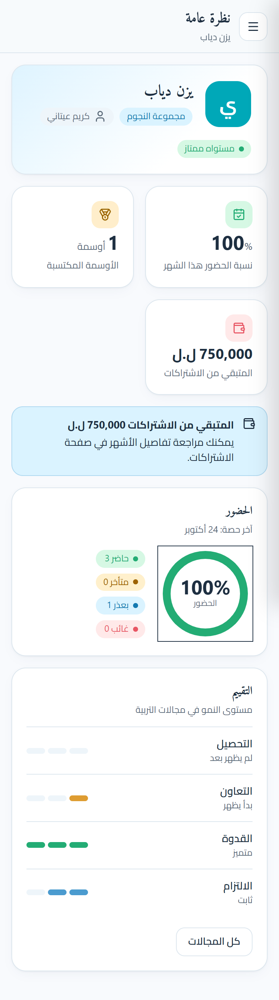 |

### Accountability

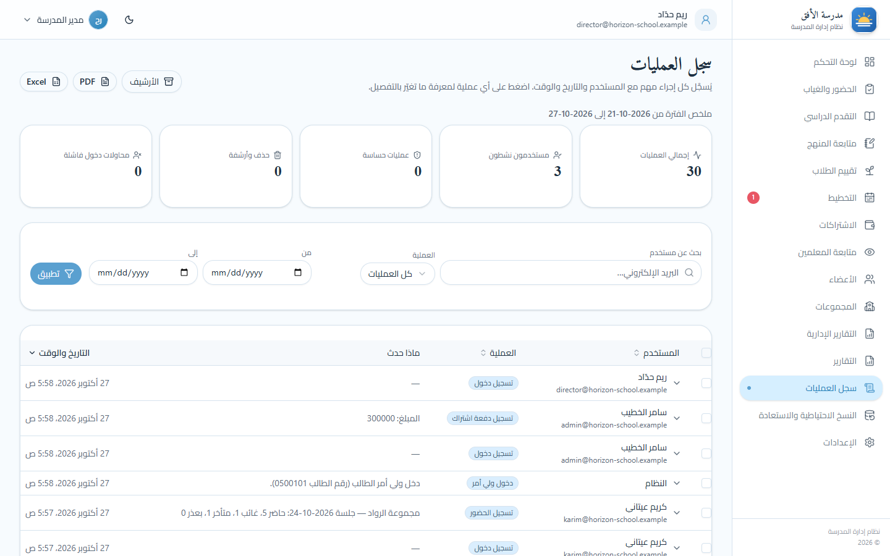

Every important action is recorded with the user, the date and the time. Sign-ins are kept 90 days, other actions 12 months.

## Architecture

Every request follows the same path. There is no ORM: the API calls stored procedures directly.

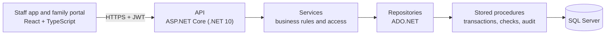

| Layer | Technology |
|---|---|
| Interface | React, TypeScript, Vite, Tailwind CSS, shadcn/ui; Arabic only, right-to-left; works offline for attendance |
| API | ASP.NET Core (.NET 10), JWT authentication, policy-based authorization |
| Data | SQL Server; ADO.NET and stored procedures only |
| Quality | Browser, API and unit test suites; continuous integration on every push |

## In this repository

| | |
|---|---|
| [How it works, role by role](docs/how-it-works.md) | What the director, supervisor, team leader, teacher and parent see and do. |
| [Architecture](docs/architecture.md) | Layers, principles, one request end to end, offline attendance. |
| [Database](docs/database.md) | What the database holds and the rules it enforces. |
| [Security](docs/security.md) | Who can see what, sign-in protection, the family domain, backups. |
| [Testing and delivery](docs/testing-and-delivery.md) | How the system is tested and shipped. |
| [Glossary](docs/glossary.md) | The Arabic interface terms in the screenshots, in English. |
| [`CASE-STUDY-KIT.md`](CASE-STUDY-KIT.md) | Descriptions, key numbers and captions for writing about the project. |

## Status

Deployed and in use at a school. Built alone, from scratch to deployment: design, database, API, interface and testing. The repository that holds the code is private.

## About

Built by **Anas Fawaz**, full stack software developer, Beirut. For a walkthrough or questions, get in touch through my GitHub profile.

## Copyright

© Anas Fawaz. All rights reserved. The source code is private and is not licensed for copying, modification or redistribution. The screenshots and text in this repository may be shared with credit.
