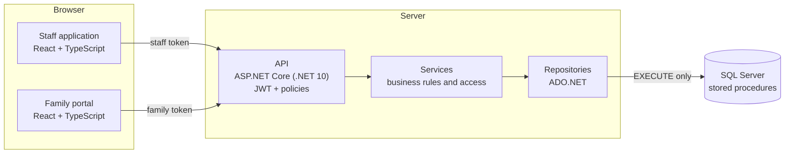
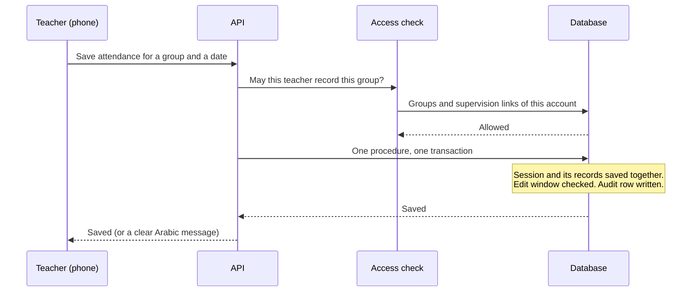

# Architecture

Every request follows the same path: **controller → service → repository → ADO.NET → stored procedure**. There is no ORM.

## Principles

- **Each rule lives in one place.** A rule that must never disagree between two screens (who may edit a record, until when, who may see which student) lives in a stored procedure or in a single service, never in the screens.
- **Each layer has one job.** Controllers handle HTTP, services handle rules, repositories handle data.
- **SQL stays close to the data.** Transactions, checks and audit rows run in the database, in one step.
- **The API cannot touch tables.** The API connects to the database as a login that can only run stored procedures. Even a bug in the API cannot run free-form SQL against the tables.
- **The server decides.** The interface hides what a user may not do, but every request is authorized again on the server against the data, not just against the menu.
- **Time is stored in UTC** and shown in the viewer's local time.

## One request, end to end: saving attendance

Attendance is saved as **one transaction**: the session, its records and the audit row together. There is one session per group per date, so duplicates are impossible. If a teacher tries to overwrite another teacher's session, the API refuses with a clear message.

## Two security domains

The family portal is built as a separate domain, not as a restricted staff login:

- its own sign-in (student number and PIN),
- its own token with its own audience and signing key,
- its own API client in the browser.

The student always comes from the token, never from the address, so editing a URL can never reach another child. Staff tokens do not work on family endpoints, and family tokens do not work on staff endpoints. A new PIN, an archived student or a switched-off account ends the family's session within seconds, because the token is re-checked against the database.

## Offline attendance

On a phone without internet, attendance is kept in an on-device outbox, per account, and sent by itself when the connection is back; the top bar shows how many records are waiting. Attendance is an upsert by group and date, and every progress record carries a client-generated ID, so a resend is never saved twice. A service worker keeps only the application's own files (never API answers), so the site also opens offline.

## Speed

- The API opens its database connections and warms the sign-in path at start.
- The account check on each request is cached for a short time and cleared at once when an account changes.
- Responses are cached on the server with a version that any write invalidates; family answers are cached per account and per student.
- Dashboards ask for the data of every group in one batched request.

## Scheduled jobs

Background jobs write the automatic monthly reports, prune old audit rows, and run on a schedule beside the daily and monthly database backups (each backup is verified after it is written). The director's health card summarises the result.
