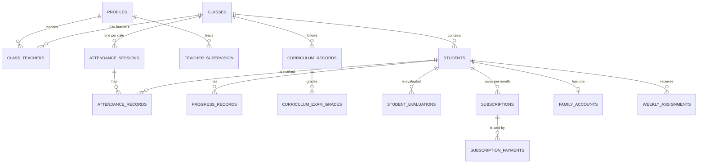

# Database

SQL Server, with an Arabic collation (`Arabic_100_CI_AS`) so Arabic text sorts and compares correctly. The schema is applied from numbered scripts and the procedures from one file each (`CREATE OR ALTER`), so deploying is safe to repeat. **31 tables** and **more than 150 stored procedures**.

## What it holds

| Area | Tables |
|---|---|
| People and groups | profiles (staff), profile capabilities, students, classes (groups), class teachers, teacher supervision, student history, retired student numbers |
| Attendance | attendance sessions, attendance records |
| Progress and curriculum | progress records, newsletters (curriculum books), curriculum records, curriculum exam grades, follow-ups |
| Evaluations | student evaluations, student pins (medals) |
| Subscriptions | subscription prices, subscriptions, subscription payments |
| Planning and notes | plans, notes, note recipients |
| Family | family accounts, weekly assignments |
| Reports and system | admin reports, auto-report runs, app settings, system events, audit logs |

## The main entities

## Rules the database enforces

These are rules in the database itself, not in the screens, so no screen or API bug can bypass them.

- **Edit windows.** Whoever recorded something may correct it for a limited time: **72 hours for attendance**, **24 hours** for progress, curriculum, payments, notes and evaluations. Afterwards only administrators can. One SQL function (`fn_CanEditRecord`) makes this decision for every record type.
- **One attendance session per group and date.**
- **One subscription row per member and month**, and one set price per year and member kind. A partial payment is split evenly over the months it covers.
- **Student numbers are never reused.** Students and staff share one number series; when a student is deleted for good, their number is written to a retired list and never given again, and nobody is renumbered.
- **Archive instead of delete.** A deleted student, staff account, group, curriculum entry or report moves to the archive with no time limit. Restoring brings it back as it was; a group whose name was taken meanwhile returns as "… (2)". Deleting for good removes the item with its dependent records.
- **One family account per student**, with only the PIN's hash stored, and a lock that grows with each round of wrong PINs.
- **Evaluations describe growth.** Levels run from 0 to 3 and are checked by the database; they are never added up per student.
- **Audit rows are written in the same transaction** as the change they describe. Retention is enforced by a job: sign-in rows are kept 90 days, other actions 12 months.
- **Least privilege.** The API's database login can execute procedures and has no rights on any table.
- **Read-committed snapshot isolation** is on, so the many teachers who take attendance on class day do not block each other.
