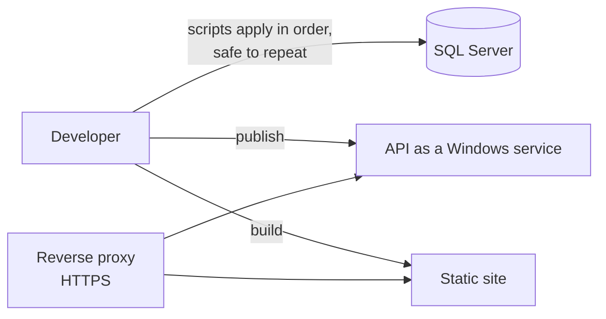

# Testing and delivery

The project's own test README counts **about 800 automatic checks**, spread over **55 end-to-end and API suites** and **3 C# unit-test files**.

## How testing is organised

| Kind | Tooling | What it covers |
|---|---|---|
| API and business-rule checks | Node, against the running API | Roles, scoping, validation, time windows and the Arabic error messages, tested at their exact boundaries. |
| Browser checks | Playwright, end to end | Real pages, signed in as each kind of account, on desktop and phone widths, including forms, dialogs, exports and page speed. |
| C# unit tests | xUnit, no database | Logic that needs no database, such as sign-in throttling, the server cache and the scheduled clean-up job. |

The suites run against a **test copy of the database**, never production. Everything they add is tagged and removed at the end.

### What the checks prove, with examples

- **Edit windows at their exact limits.** A teacher can correct attendance at 71 hours and is refused at 73.
- **Every role against every page.** A role matrix signs in as each kind of account and checks what it can and cannot reach.
- **Family portal isolation.** One child's data is never reachable from another family's account; the lock after wrong PINs, the rate limit and the audit trail are checked, and so is the server cache, which must never leak one family's answer to another.
- **Offline attendance.** Records kept on a phone are sent when the connection returns and are never saved twice.
- **Payments.** Full and partial payments, and the even split of a partial payment over months.
- **The archive.** Deleting, restoring and deleting for good, for each kind of record.
- **Accounts.** Creating accounts, changing roles, the first account, and the sign-in lockouts.

Two suites act as **release gates**: the API contract check (answer shapes, errors, security headers and a scan that no endpoint is open to anonymous users by accident) and the role matrix.

## Continuous integration

On every push and pull request, GitHub Actions:

1. builds the API and runs the C# unit tests;
2. type-checks, lints and builds the web application.

CI needs no database and no secrets. The end-to-end suites run locally against a test copy of the database.

## Delivery

- **Database:** one script creates or updates the database from the numbered schema files, then the stored procedures, then the least-privilege login and its rights. It is idempotent, so it can be run again to apply updates.
- **API:** published and run as a Windows service behind a reverse proxy with HTTPS. The environment, the allowed website address and the signing key are set on the server, never in the code.
- **Site:** built with the real API address and served as a single-page application, with security headers (a content security policy limited to the API's address, frame and referrer policies).
- **Backups:** a daily backup and a monthly archive, each verified after it is written (see [Security](security.md)).
- **Logs and health:** daily log files kept 30 days, and a health card for the director showing the database, the last backup, errors today, the last automatic report and the size of the audit log.
